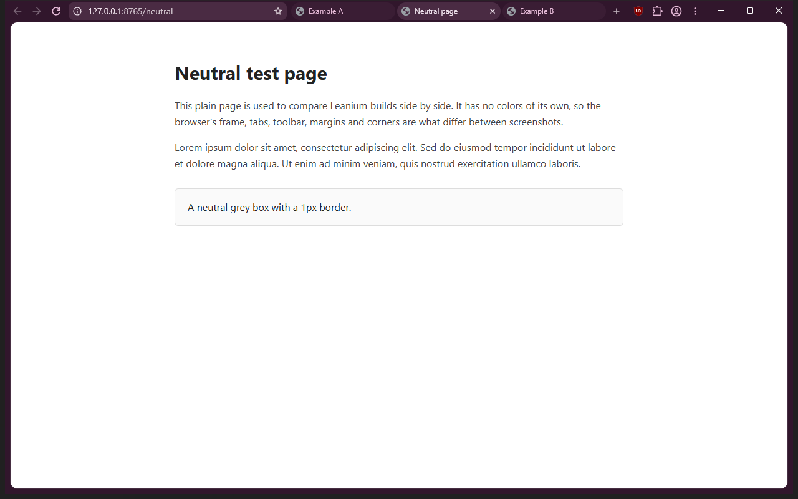
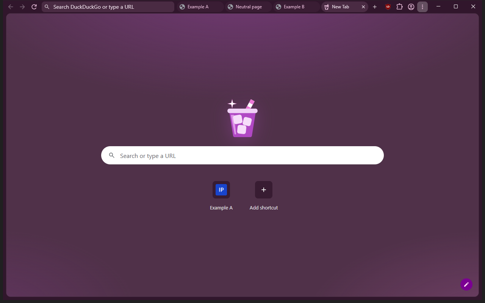
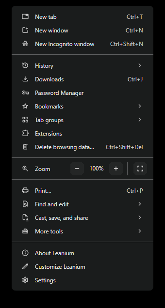
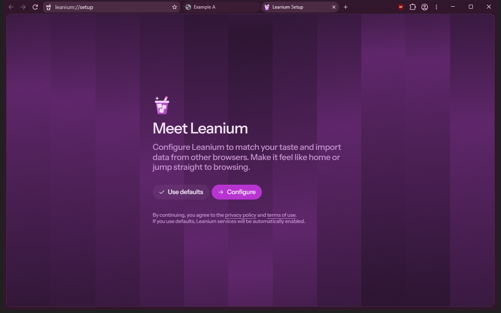

<div align="center">


# Leanium

A rebranded build of the [Helium](https://github.com/imputnet/helium) browser, based on Helium,
with Chromium's built-in password manager turned back on and a calmer, Zen-style look
(horizontal tabs).

[](https://github.com/ezph4ntom/Leanium/releases/latest)
[](LICENSE)


**[Download](https://github.com/ezph4ntom/Leanium/releases/latest)** ·
[Changelog](CHANGELOG.md) ·
[Build it yourself](docs/BUILDING.md)

</div>

---

Helium is a fast, privacy-minded Chromium browser, but it switches off Chromium's own password
manager and expects you to use an extension instead. Leanium is the same browser with that
decision reversed: passwords are saved, filled in and managed by the browser itself, with nothing
extra to install.

It installs **next to** Helium under its own name, icon and profile, so you can keep both.

<p align="center">
  
</p>

<p align="center">
  
  
  
</p>

## Install

1. Get `Leanium-<version>-x64-installer.exe` from the
   [latest release](https://github.com/ezph4ntom/Leanium/releases/latest).
2. Run it and choose *Install for current user only*. **The installer is not code-signed, so Windows
   SmartScreen may warn** that the publisher is unknown. Choose *More info → Run anyway*.
3. When updating, install the new version over the old one. You don't need to uninstall first.
   Export your passwords before updating, just in case (see below).

Each release lists a SHA-256 checksum. To verify your download in PowerShell:

```powershell
Get-FileHash .\Leanium-0.22.2.1-x64-installer.exe
```

## What is different from Helium

| | Helium | Leanium |
| --- | --- | --- |
| Password manager | Disabled by policy | Enabled, saving on by default |
| *Autofill and passwords* in Settings | Hidden | Shown |
| Passwords in the main menu | – | *⋮ → Password Manager* |
| Top bar | Tabs and toolbar in two rows | One row (compact layout) |
| Tabs | Rounded active tab, separator lines | Pill-shaped tabs, no separators |
| Page | 3 px gap, small corners | Floats as a card: 8 px gap, 12 px corners |
| Colours | Grey | Purple accent from the cup logo (#B048C4) |
| New-tab page | Shortcuts only | Cup logo, search box (your default engine), shortcuts |
| Name, icon, installer, setup page | Helium | Leanium (cup logo, Leanium colours) |
| Internal pages | `helium://settings` | `leanium://settings` |
| Install IDs and profile | Helium's | Separate, so both can be installed side by side |

The layout, colours and *Frameless mode* (hide the toolbar until you hover the top edge) can be
changed in *Settings → Appearance*. Everything else (the privacy defaults, the built-in uBlock
Origin) comes from Helium unchanged. A before/after comparison is in
[`ui-screenshots/before-after.png`](ui-screenshots/before-after.png).

## Good to know

- **No automatic updates.** Since 0.22.2.1 the About page (*⋮ → Help → About Leanium*) says when a
  newer release is on GitHub, with a download link; it never downloads or installs anything itself.
  You can also watch this repository's releases (*Watch → Custom → Releases*). New builds follow
  Helium releases, which carry Chromium security fixes.
- **Saved passwords are local only and are not synced** to any account or device (the password
  settings page says so too). **Export them regularly** as a backup:
  *⋮ → Password Manager → Settings → Export passwords*. After each update, run the short
  [`MOODLE_LOGIN_TEST.md`](MOODLE_LOGIN_TEST.md) checklist (save, autofill, export).
- **The installer is unsigned**, so Windows SmartScreen may warn when you run it.
- **Unofficial.** Leanium is a personal project. It is not affiliated with or supported by the Helium
  project, imput, or Google.

## How it is made

Leanium is not a fork of the browser code. This repository holds a small set of scripts that edit
Helium's Windows build recipe before compiling:

| Path | Purpose |
| --- | --- |
| [`scripts/apply.py`](scripts/apply.py) | Enables the password manager, renames Helium to Leanium, sets new install IDs, adds the logo |
| [`patches/`](patches) | Leanium's own Chromium patches, applied after Helium's |
| [`scripts/update.bat`](scripts/update.bat) | Moves to a new Helium release and rebuilds in one command |
| [`scripts/check_leftovers.py`](scripts/check_leftovers.py) | Scans a finished build for any visible "Helium" text |
| [`scripts/make_release.py`](scripts/make_release.py) | Checks a build and publishes it as a GitHub release |
| [`assets/`](assets) | The logo, generated by [`scripts/make_assets.py`](scripts/make_assets.py) |

## Build it yourself

In short (Windows x64, Visual Studio 2022, Python 3.12, about 60 GB free disk and a few hours):

```bat
git clone --recurse-submodules https://github.com/imputnet/helium-windows.git
cd helium-windows
git checkout --recurse-submodules 0.22.2.1
git clone https://github.com/ezph4ntom/Leanium.git leanium
py -3.12 leanium\scripts\apply.py . --assets leanium\assets\branding
py -3.12 build.py
py -3.12 package.py
py -3.12 leanium\scripts\check_leftovers.py .
```

The full walkthrough, prerequisites and fixes are in [docs/BUILDING.md](docs/BUILDING.md); updating
to a newer Helium is covered in [docs/UPDATING.md](docs/UPDATING.md).

## Credits and licence

Leanium is based on [Helium](https://github.com/imputnet/helium) (and its Windows build,
[helium-windows](https://github.com/imputnet/helium-windows)) by imput and contributors,
[ungoogled-chromium](https://github.com/ungoogled-software/ungoogled-chromium), and
[Chromium](https://www.chromium.org/). Their copyright notices are kept intact.

The scripts and patches in this repository are licensed under [GPL-3.0](LICENSE), matching Helium.
Upstream's licence files are included unmodified in [`licenses/`](licenses), and
[`NOTICE.md`](NOTICE.md) lists what comes from where. Each release names the exact Helium version and
commit of this repository it was built from.

"Helium", "Chromium" and "Google" are trademarks of their respective owners and are used here only
to describe what this project is based on.
