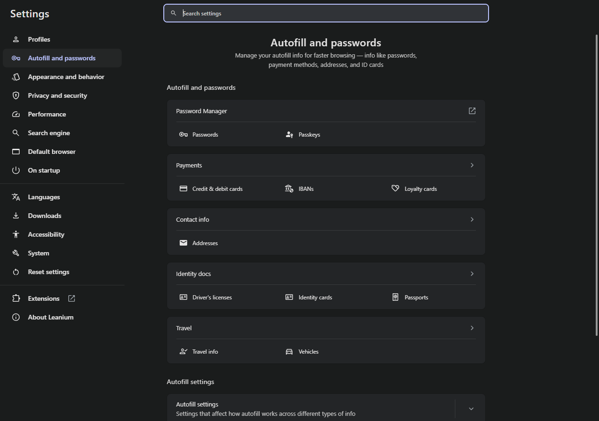

<div align="center">


# Leanium

A rebranded build of the [Helium](https://github.com/imputnet/helium) browser with Chromium's
built-in password manager turned back on.

[](https://github.com/ezph4ntom/Leanium/releases/latest)
[](LICENSE)


**[Download](https://github.com/ezph4ntom/Leanium/releases/latest)** ·
[Changelog](CHANGELOG.md) ·
[Build it yourself](docs/BUILDING.md)

</div>

---

Helium is a fast, privacy-minded Chromium browser, but it switches off Chromium's own password
manager and expects you to use an extension instead. Leanium is the same browser with that
decision reversed: passwords are saved, filled in and managed by the browser itself, with nothing
extra to install.

It installs **next to** Helium under its own name, icon and profile, so you can keep both.

<p align="center">
  
</p>

## Download

1. Get `Leanium-<version>-x64-installer.exe` from the
   [latest release](https://github.com/ezph4ntom/Leanium/releases/latest).
2. Run it. Windows SmartScreen will warn that the publisher is unknown, because the installer is not
   code-signed. Choose *More info → Run anyway*.
3. When updating, install the new version over the old one. You don't need to uninstall first.

Each release lists a SHA-256 checksum. To verify your download in PowerShell:

```powershell
Get-FileHash .\Leanium-0.21.3.1-x64-installer.exe
```

## What is different from Helium

| | Helium | Leanium |
| --- | --- | --- |
| Password manager | Disabled by policy | Enabled, saving on by default |
| *Autofill and passwords* in Settings | Hidden | Shown |
| Name, icon, installer | Helium | Leanium (cup logo) |
| Internal pages | `helium://settings` | `leanium://settings` |
| Install IDs and profile | Helium's | Separate, so both can be installed side by side |

Everything else (the privacy defaults, the built-in uBlock Origin, the interface) comes from
Helium unchanged.

## Good to know

- **No automatic updates.** Watch this repository's releases (*Watch → Custom → Releases*) to be
  told when a new build is out. New builds follow Helium releases, which carry Chromium security fixes.
- **Passwords stay on this PC.** They are not synced anywhere (the password settings page says so
  too). Back them up now and then from
  *Settings → Autofill and passwords → Password Manager → Settings → Export passwords*.
- **Unofficial.** Leanium is a personal project. It is not affiliated with or supported by the Helium
  project, imput, or Google.

## How it is made

Leanium is not a fork of the browser code. This repository holds a small set of scripts that edit
Helium's Windows build recipe before compiling:

| Path | Purpose |
| --- | --- |
| [`scripts/apply.py`](scripts/apply.py) | Enables the password manager, renames Helium to Leanium, sets new install IDs, adds the logo |
| [`patches/`](patches) | Leanium's own Chromium patches, applied after Helium's |
| [`scripts/update.bat`](scripts/update.bat) | Moves to a new Helium release and rebuilds in one command |
| [`scripts/check_leftovers.py`](scripts/check_leftovers.py) | Scans a finished build for any visible "Helium" text |
| [`scripts/make_release.py`](scripts/make_release.py) | Checks a build and publishes it as a GitHub release |
| [`assets/`](assets) | The logo, generated by [`scripts/make_assets.py`](scripts/make_assets.py) |

To build it yourself, see [docs/BUILDING.md](docs/BUILDING.md). Updating to a newer Helium is
covered in [docs/UPDATING.md](docs/UPDATING.md).

## Credits and licence

Leanium is built on [Helium](https://github.com/imputnet/helium) by imput and contributors,
[ungoogled-chromium](https://github.com/ungoogled-software/ungoogled-chromium), and
[Chromium](https://www.chromium.org/). Their copyright notices are kept intact.

The scripts in this repository are licensed under [GPL-3.0](LICENSE), matching Helium. Each
release names the exact Helium version and commit of this repository it was built from.

"Helium", "Chromium" and "Google" are trademarks of their respective owners and are used here only
to describe what this project is based on.
